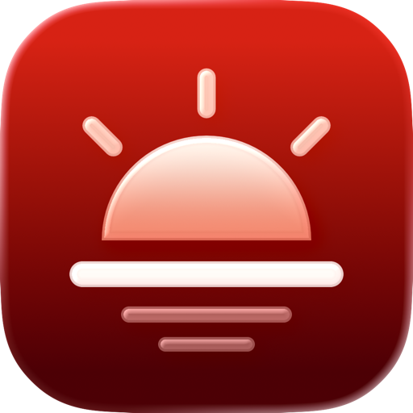
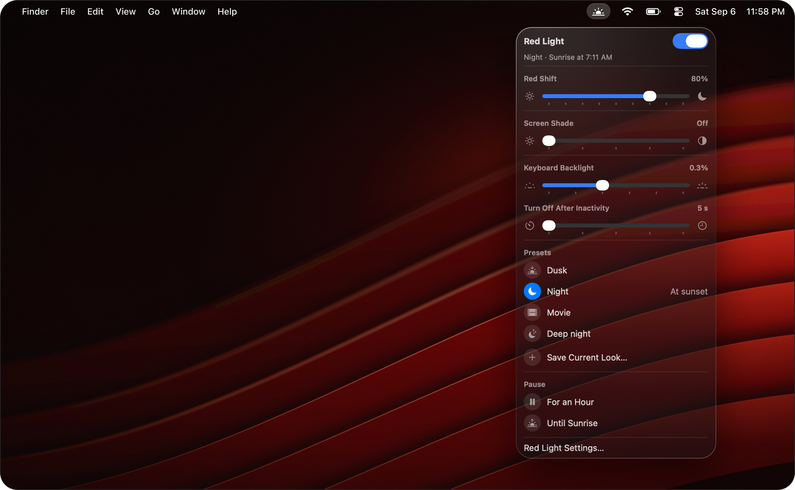

  

<h1 align="center">Red Light</h1>

  <b>Zero blue. Sleep better.</b> 
  A menu bar app that takes every trace of blue out of your Mac at sunset — 
  across a thirty-minute fade you never notice — with presets for after dark that it learns to pick for you.

  

  Free and open source · Apple silicon · macOS 26 or later · <a href="https://ervinyoung.github.io/Red-Light-for-mac/">Website</a>

  

- **Native, not bolted on.** A Control Center panel one click from the menu bar, built from the system's own
  controls, type and colour. Sliders apply live as you drag. Nothing new to learn.
- **Gradual, not a switch.** Red Shift, the screen shade and the keyboard backlight all ease from your day
  settings to your night ones over thirty minutes from sunset, in steps too small to catch, and back at sunrise.
- **Presets for after dark.** Dusk to ease in, Night to settle, Movie to drop the whole screen back, Deep night
  for the last hour. Each one moves the display, the keyboard and the shade together.
- **It learns.** Settle on the same adjustment three nights out of the last fourteen and it becomes your default —
  the transition time included. It never fights a change in the moment; it just stops needing to be told.
- **True color when it matters.** Open Figma, Sketch or Photoshop at night and it offers true color while that app
  is in front, then brings the red back when you switch away.

## The science
Controlled human studies, each linked to its paper:
- **55% less evening melatonin** and a **1.5 h later circadian clock** after reading on a light-emitting screen instead of paper, with reduced next-morning alertness. Chang, Aeschbach, Duffy & Czeisler, [PNAS 2015](https://www.pnas.org/doi/10.1073/pnas.1418490112).
- **99% of people** had a delayed melatonin onset under ordinary room light before bed; melatonin duration shortened by **~90 min**. Gooley et al., [J Clin Endocrinol Metab 2011](https://doi.org/10.1210/jc.2010-2098), n = 116.
- The **blue content** of a display, not its brightness or colour, predicts melatonin suppression and sleep latency; "spectrally tuning the visual display light" is the fix. Schöllhorn et al., [Communications Biology 2023](https://doi.org/10.1038/s42003-023-04598-4), n = 72.
- The retinal cells that set the clock peak near **480 nm**, in a display's blue. Berson, Dunn & Takao, [Science 2002](https://doi.org/10.1126/science.1067262).

Red Light for Mac is not a medical device and makes no medical claims.

## Install
**[Download Red Light](https://github.com/ervinyoung/Red-Light-for-mac/releases/latest/download/Red-Light.dmg)** (Apple silicon, macOS 26 or later), open it, and drag Red Light to Applications.

The first time you open it, macOS asks you to confirm: System Settings › Privacy & Security › **Open Anyway**
(the app isn't notarized). After that it sets itself up — the sunrise/sunset scheduler, your location for sun
times, default presets — and keeps itself up to date: it checks GitHub once a day, installs only updates signed
with the project's key, and only while no red is on screen. Settings › Updates turns that off.

To remove it: switch Red Light off, quit it, drag it to the Trash, then stop the sunset scheduler it installed:

    launchctl bootout gui/$(id -u)/com.ervinyoung.redlight; rm ~/Library/LaunchAgents/com.ervinyoung.redlight.plist

`rm -r ~/Library/Application\ Support/RedLight` also deletes your settings. From a clone, `./uninstall.sh` does
all of this (`--all` includes settings).

### From source
Xcode Command Line Tools (`xcode-select --install`), then:

    git clone https://github.com/ervinyoung/Red-Light-for-mac && cd Red-Light-for-mac && ./install.sh

Run `./install.sh` again to update; your settings, what it has learned and the switch are kept. A source build
also updates itself from GitHub releases like the download does, unless Settings › Updates is off.
`./release.sh` builds the disk image, the update zip and its signature into `dist/`; `--publish` uploads them
as a GitHub release (signing needs the update key in your login Keychain).

## Terminal
Make a shortcut once:

    echo 'alias redlight="$HOME/Library/Application\ Support/RedLight/redlight"' >> ~/.zshrc && source ~/.zshrc

    redlight on | off            the master switch: off restores the normal display and nothing happens at sunset
    redlight status              mode, fade progress, pause, sun times, current settings, location
    redlight suntimes            today's sunrise / sunset and the effective switch times
    redlight night | day         switch now (instant, no fade; night also turns the switch on)
    redlight pause 60            pause for 60 minutes (restores the day look, learns nothing meanwhile)
    redlight pause sunrise       pause until the next sunrise
    redlight resume              end a pause (and turn the switch on)
    redlight set warmth 80       the unified control, 0–100 or off (see below)
    redlight set keyboard 0.3    keyboard backlight in percent (0.1–30) or off
    redlight set idle 30         keys off after N seconds of inactivity
    redlight set shade 40        screen shade 0–90 or off
    redlight preset list | apply "Night" | save "Reading" book.fill | night "Night" | delete "Reading"
    redlight shade on|off|toggle|up|down|<0-90>
    redlight location 37.43 -122.14 [manual|auto]
    redlight learned | forget
    redlight hold Figma          true colour while a colour-critical app is in front (the look is kept, not changed)
    redlight release             the red back after a hold
    redlight curve               print the warmth curve

While the switch is off, `pause`, `set`, `preset apply` and `shade` refuse; turn it on first.

## Red Shift: one slider, two mechanisms
Two ways to cut blue light have opposite strengths. Scaling the display's blue and green channels at the
gamma table (what Night Shift and f.lux do) physically removes blue while every pixel keeps its brightness
ordering, so text stays crisp — but it cannot go "beyond zero", and content that lives only in a removed
channel goes dark. Apple's Color Tint filter maps each pixel to its luminance and mixes toward red: nothing
disappears, but hue collapses, and at high intensity everything is the same red blob.

Red Light's Red Shift (`warmth` in the config and CLI) uses each where it is best:

    0–60 %    channel scaling only: blue 100 % → 0, green trimmed to 60 %. Maximum legibility.
    60–100 %  blue stays at zero; green eases to 35 % while a modest luminance-preserving tint (up to 50 %)
              folds the removed green back into red brightness instead of letting it fade to black.

80 % is the default at night. 60 % is the knee: no blue at all, no tint at all.
The gamma legs are drawn by the menu bar app and the tint leg by the engine; `shade.json` carries both.

## Sunset and sunrise
Location comes from the Mac (Location Services, only ever used for sun times, never leaves the machine).
Until permission is granted it is guessed from the time zone; you can also enter coordinates in Settings.
Transitions fade over 30 minutes by default (Settings › Transition; `fadeMinutes` in config.json). Warmth and
shade ease linearly, keyboard brightness logarithmically. If you adjust anything mid-fade, the fade stops and
leaves it where you set it. Waking from sleep triggers an immediate check; a fade that should have happened
while asleep is picked up at the point the clock says it should be.

## Learning
Every minute the engine compares the current settings with what it last saw; a difference is a manual change,
recorded in `events.jsonl`. It never fights a change in the moment. When the value you settle on at night is
about the same on 3 of the last 14 nights it becomes the night default, and when you switch warmth on or off
by hand near a transition on 3 nights, the transition moves (never more than 2 hours). One notification, at
most once a day. `learned.json` holds what it adopted and a dated history; `redlight forget` clears it.

## Files
    config.json      night preset, day defaults, location + source, fade length, learning, presets, shortcuts
    state.json       the master switch, mode, day snapshot, fade in progress, pause, true-colour hold
    learned.json     adopted adjustments and history
    events.jsonl     observed manual changes (pruned past the lookback window)
    shade.json       what the app should draw: shade overlay, warmth, gamma multipliers
    commanded.json   the keyboard brightness last set (the hardware reports 0 once it idle-dims)
    redlight         the engine, installed from inside the app on every launch
    redlight.log     transitions, noticed changes, learned adjustments (rotated to redlight.log.1 at 1 MB)
    launchd.err.log  anything the agent's runs write to stderr

## Menu bar app
Icon: the sun at the horizon — outline while waiting for sunset, filled at night, dimmed while paused or off
at the master switch.
Panel: Red Shift · Screen Shade · Keyboard Backlight · Turn Off After Inactivity (sliders snap to detents and
apply live, and carry a mark under the track at each saved preset's resting point) · Presets (tap to apply;
right-click for Use at Sunset / Replace / Delete; + saves the current look) · Pause · Settings.
Global shortcuts: ⌃⌥⌘S toggles the shade, ⌃⌥⌘↑ / ⌃⌥⌘↓ adjust it.
The switch at the top right is the master switch and means what the Wi-Fi switch means: off restores your
normal display and nothing happens at sunset; on follows the sun again and clears any pause. During the day
the top of the panel shows a "Waiting for sunset" row with the time it will start and a "Turn On Now" row if
you want the night look before then; every control stays live, the scheduler just hasn't applied anything yet.
Shade and warmth exist only while the app runs (macOS restores the gamma table when it exits).
Rebuild everything from the repo with `./install.sh`, or only the app with `app/build.sh`.
The agent (`~/Library/LaunchAgents/com.ervinyoung.redlight.plist`, a `redlight check` every minute) stays loaded:
off is the switch or `redlight off`, not unloading it. The app loads an unloaded agent again, and an older build
expressed "off" that way, so an unloaded agent can come back as off.
