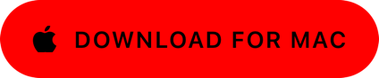
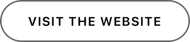
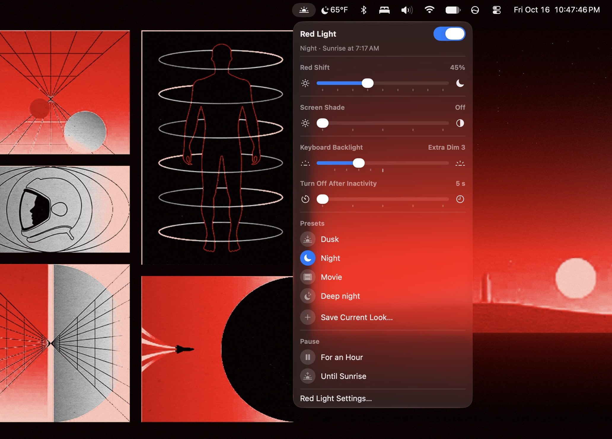

<p align="center">
  
</p>

<h1 align="center">Red Light</h1>

<p align="center">
  <b>Zero blue. Sleep better.</b><br>
  A menu bar app that removes blue light from your Mac's display after sunset.
</p>

<p align="center">
  <a href="https://github.com/ervinyoung/Red-Light-for-mac/releases/latest/download/Red-Light.dmg"></a>
  &nbsp;
  <a href="https://ervinyoung.github.io/Red-Light-for-mac/"><picture>
    <source media="(prefers-color-scheme: dark)" srcset="docs/img/btn-site-dark.png" width="196" height="44">
    
  </picture></a>
</p>
<p align="center">
  <sub>Free and open source · Apple silicon · macOS 26 or later</sub>
</p>

<p align="center">
  <a href="https://ervinyoung.github.io/Red-Light-for-mac/"></a>
</p>

<p align="center">
  <b>See Red Light in action at <a href="https://ervinyoung.github.io/Red-Light-for-mac/">ervinyoung.github.io/Red-Light-for-mac</a>.</b>
</p>

## Features

- **Native.** A Control Center panel in your menu bar.
- **Gradual.** Blue fades out over 30 minutes after sunset and comes back at sunrise.
- **Room-aware.** Remembers your red for dark, dim, and lit rooms, and follows the lamps.
- **Presets.** Dusk, Night, Movie, and Deep night set the display, keyboard, and screen shade at once.
- **Adaptive.** Settings you choose on 3 of 14 nights become your defaults.
- **True color.** Figma, Sketch, and Photoshop get accurate color while they're in front.
- **Dimmer keys.** Extra Dim 1 to 4: four keyboard backlight levels below macOS's minimum.

Evening screen light cuts melatonin by 55% and delays your body clock by 1.5 hours
([Chang et al., PNAS, 2015](https://www.pnas.org/doi/10.1073/pnas.1418490112)). Red Light isn't a medical device.

## Install Red Light

Red Light requires a Mac with Apple silicon and macOS 26 or later.

1. Download [Red-Light.dmg](https://github.com/ervinyoung/Red-Light-for-mac/releases/latest/download/Red-Light.dmg), and then drag **Red Light** to **Applications**.
2. Open **Red Light**. The first time, macOS blocks the app because it isn't notarized. In
   **System Settings > Privacy & Security**, click **Open Anyway**.

Red Light sets itself up and updates itself. To uninstall it, see [Uninstall Red Light](DETAILS.md#uninstall-red-light).

## Build from source

```sh
git clone https://github.com/ervinyoung/Red-Light-for-mac && cd Red-Light-for-mac && ./install.sh
```

For the command line, how Red Shift works, and the files Red Light stores, see the [reference](DETAILS.md).
